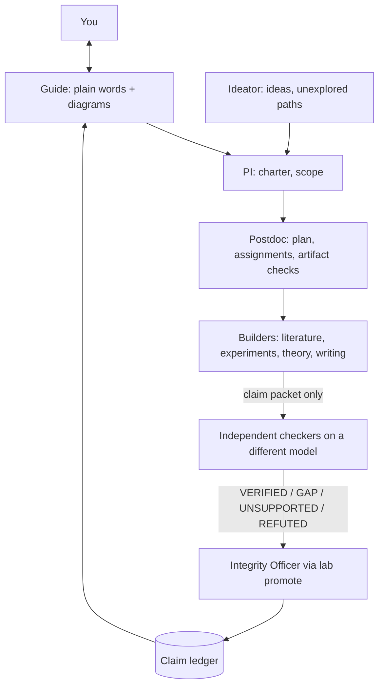

# WeSearch

A model-agnostic research lab: plain files, role prompts, and a small `lab` CLI that enforces review. Works with any chat model through any OpenAI-compatible API, and any coding agent that can read `LAB.md`.

## How it fits together



## Setup
```bash
python3 -m venv .venv && .venv/bin/pip install -r requirements.txt
git config core.hooksPath githooks
```
Edit `lab.yaml`: set a model per tier, and put the `reviewer` tier on a different vendor than the builders. Export the API keys it names.

## First steps
1. Fill in `research/charter.md` with the Guide. `scripts/lab gate charter` must pass.
1b. Fill in `research/lit-protocol.md` and `research/protocol.md`, then freeze: `scripts/lab prereg` (`--amend "reason"` for later deviations, `--check` to verify).
2. Add a claim: `scripts/lab claim add H1a "text" --kind empirical --charter H1`
3. Attach evidence and assumptions: `scripts/lab claim evidence H1a research/runs/run-001`
4. Review: `scripts/lab review H1a adversarial-reviewer`
5. Promote: `scripts/lab promote H1a single-run --reason "..."` (refuses unless the rules are met)
6. See everything: `scripts/lab status`

## What is enforced by code (not by a model's goodwill)
- One rung at a time; required reviewers' verdicts must be `VERIFIED` and **fresh** (any edit to the claim, assumptions or evidence makes them stale).
- Any open non-`VERIFIED` verdict blocks promotion.
- Evidence files must exist. Run folders need command, seed, env and log.
- Reviewers see only a claim packet, never the author's reasoning.
- `lab draft-check`: numbers need `[run:<id>]`, strong wording needs a `[claim:<id>]` whose status supports it, figures need `script:<path>`.
- `lab cite-check`: DOIs and arXiv ids must resolve. Claims resting on `research/literature/` files also need a fresh `citation-auditor` VERIFIED (quote vs claim).
- `lab prereg`: protocol hashed and timestamped before runs; empirical claims cannot reach `single-run` if it changed without `--amend`.
- `lab drift`, `lab gate <phase>`, `lab impact <assumption>`, and an audit log at `research/logs/audit.jsonl`.

## What is NOT enforced (be honest with yourself)
- `cite-check` proves a reference exists, not that it says what the draft claims.
- `prereg` proves the protocol file is unchanged since freezing; it cannot prove no run happened before freezing. Commit the lock file so git history shows the order.
- The `citation-auditor` sees only quotes in the packet; it cannot catch a fabricated quote. Check quotes against the paper yourself.
- `drift` is a keyword heuristic. It cannot see meaning.
- `machine-checked` only means a proof-check log and proof file exist; the proof auditor must run the tool, and you should look at the log.
- Reviewers are models. Test them with `tests/reviewer-regression/` and rotate any that approve known flaws.
- `lab promote` can be run by anyone with shell access; keep it as the Integrity Officer's step and review the git history of `claims.yaml`.

## Tests
`python3 tests/test_lab.py` (uses a fake local model server).
