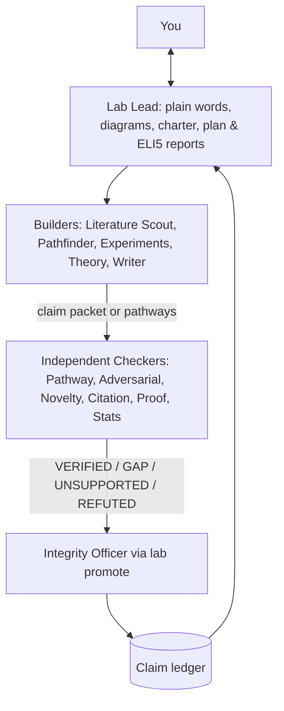

# WeSearch

A model-agnostic research lab: plain files, role prompts, and a small `lab` CLI that enforces review. Works with any chat model through any OpenAI-compatible API, and any coding agent that can read `LAB.md`.

## How it fits together



## Setup
```bash
python3 -m venv .venv && .venv/bin/pip install -r requirements.txt
git config core.hooksPath githooks
```
Edit `lab.yaml`: set a model per tier, and put the `reviewer` tier on a different vendor than the builders (or use `--prepare` / `--record` / `--from-file` to run roles via native coding-agent subagents without external HTTP calls).

## Phase 0: Scouting a new field & generating an ELI5 report
Before locking a hypothesis in `research/charter.md`, the **Lab Lead** (`roles/lab-lead.md`) can scout a broad topic (`SCOUT:<topic>`):
1. Create a scouting brief at `research/reports/<topic>-brief.md`.
2. Search real papers via arXiv and CrossRef:
   ```bash
   scripts/lab lit-search "<query>" --max 10 --out research/literature/<topic>.md
   scripts/lab cite-check research/literature/<topic>.md
   ```
3. Run `literature-scout`, `pathfinder`, and `pathway-reviewer` via explicit handoff packets (`scripts/lab run <role> --handoff <packet.yaml> --out <path>`, or `--prepare` + native subagent + `--record`).
4. Synthesize a 5-part **ELI5 & Jargon-Translated Research Report** (`research/reports/<topic>.md`, see `research/reports/TEMPLATE.md`), synchronize all `### Jargon Decoder` terms with `research/glossary.md`, and verify mechanically:
   ```bash
   scripts/lab report-check research/reports/<topic>.md
   scripts/lab gate scout --topic <topic>
   ```

## First steps (Phase 1+: Charter to Promotion)
1. Fill in `research/charter.md` with the Lab Lead using an explicit handoff packet (see [Handoffs](docs/handoffs.md)). `scripts/lab gate charter` must pass.
1b. Fill in `research/lit-protocol.md` and `research/protocol.md`, then freeze: `scripts/lab prereg` (`--amend "reason"` for later deviations, `--check` to verify).
2. Add a claim: `scripts/lab claim add H1a "text" --kind empirical --charter H1`
3. Attach evidence and assumptions: `scripts/lab claim evidence H1a research/runs/run-001`
4. Review: `scripts/lab review H1a adversarial-reviewer`
5. Promote: `scripts/lab promote H1a single-run --reason "..."` (refuses unless the rules are met)
6. See everything: `scripts/lab status`

## Exploring new directions
```bash
scripts/lab run pathfinder --handoff research/handoffs/pathfinder.yaml --out research/pathways.md
scripts/lab run pathway-reviewer --handoff research/handoffs/pathway-review.yaml --out research/logs/pathway-review.md
```
Each handoff names the charter item, decision rationale, evidence, task, expected output, and completion test. Only its explicitly listed source files are sent to the recipient; prior agent conversations are never forwarded. See [Handoffs](docs/handoffs.md) for the packet format and audit behavior.
The Pathfinder proposes 3–5 directions, each with the cheapest test that would kill it. The Pathway Reviewer (independent, reviewer model) returns `PURSUE / HOLD / REJECT` per pathway, and every objection must be tagged `EVIDENCE` (cited to the bundle) or `SPECULATION`. Novelty doubts become `NEEDS NOVELTY CHECK` tasks for the Literature Scout / Novelty Analyst — the reviewer cannot settle them from memory. Only you can promote one into the charter.

## What is enforced by code (not by a model's goodwill)
- One rung at a time; required reviewers' verdicts must be `VERIFIED` and **fresh** (any edit to the claim, assumptions or evidence makes them stale).
- Any open non-`VERIFIED` verdict blocks promotion.
- Evidence files must exist. Run folders need command, seed, env and log.
- Reviewers see only a claim packet, never the author's reasoning.
- `lab draft-check`: numbers need `[run:<id>]`, strong wording needs a `[claim:<id>]` whose status supports it, figures need `script:<path>`.
- `lab cite-check` and `lab lit-search`: queries arXiv and CrossRef for verifiable DOIs and arXiv ids; DOIs and arXiv ids must resolve. Claims resting on `research/literature/` files also need a fresh `citation-auditor` VERIFIED (quote vs claim).
- `lab report-check`: enforces the 5-section ELI5 report structure, diagram presence, `### Jargon Decoder` synchronization with `research/glossary.md`, certainty labels, and verified citations.
- `lab prereg`: protocol hashed and timestamped before runs; empirical claims cannot reach `single-run` if it changed without `--amend`.
- `lab drift`, `lab gate <phase>` (including Phase 0 `scout`), `lab impact <assumption>`, and an audit log at `research/logs/audit.jsonl`.

## What is NOT enforced (be honest with yourself)
- `cite-check` proves a reference exists, not that it says what the draft claims.
- `prereg` proves the protocol file is unchanged since freezing; it cannot prove no run happened before freezing. Commit the lock file so git history shows the order.
- The `citation-auditor` sees only quotes in the packet; it cannot catch a fabricated quote. Check quotes against the paper yourself.
- `drift` is a keyword heuristic. It cannot see meaning.
- `machine-checked` only means a proof-check log and proof file exist; the proof auditor must run the tool, and you should look at the log.
- Reviewers are models. Test them with `tests/reviewer-regression/` and rotate any that approve known flaws.
- `lab promote` can be run by anyone with shell access; keep it as the Integrity Officer's step and review the git history of `claims.yaml`.

## Tests
`python3 tests/test_lab.py` (uses a fake local model server).
