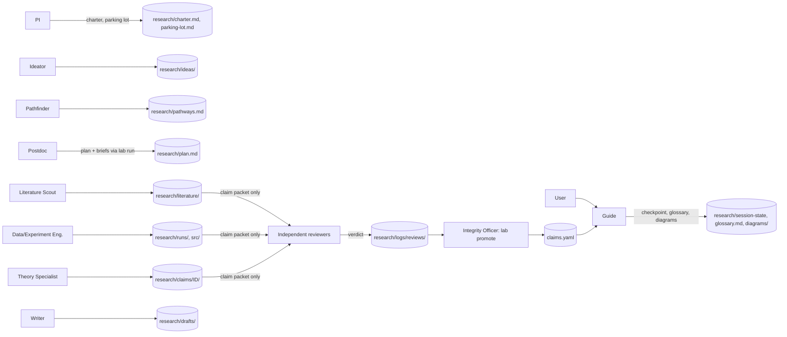
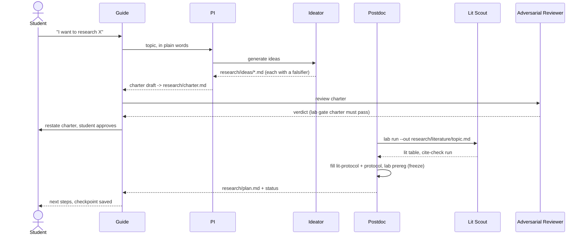
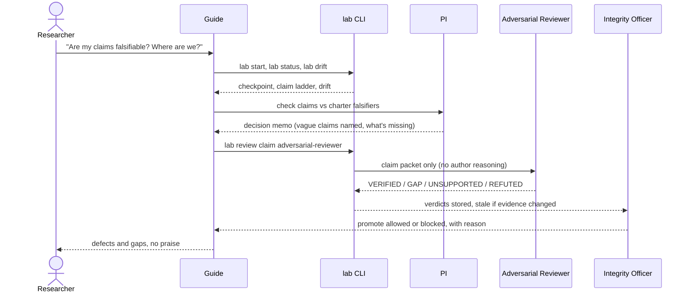
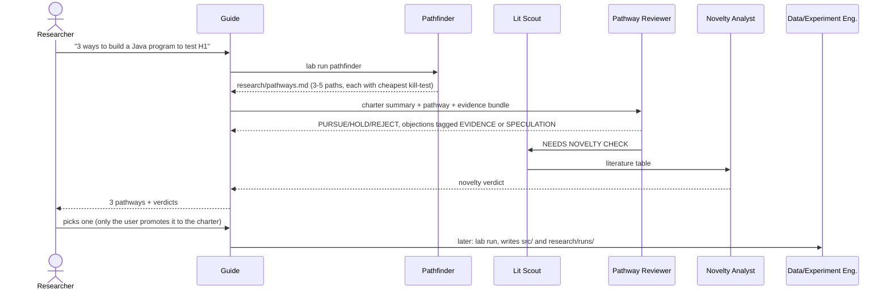

# WeSearch diagrams

## Overview: who writes what, where

## Story 1: new student forms a thesis

## Story 2: check progress and falsifiability

## Story 3: three pathways for a Java test program

