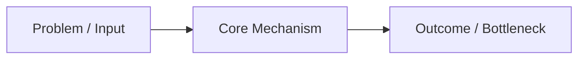

# Research Report: <topic> (charter item: <SCOUT:topic or H1>)

> Template convention: Copy this file to `research/reports/<topic>.md`, fill in every section after running the subagent swarm, synchronize all decoded terms with `research/glossary.md`, and run `scripts/lab report-check research/reports/<topic>.md`.

## 1. Mental Model (Explain Like I'm 5)

Explain the core problem and mechanism in plain words first, analogy second, technical term last. Label statements `[VERIFIED]`, `[INFERRED]`, or `[UNKNOWN]`.

## 2. What Has Already Been Done

Summarize prior work in plain English with verified `arxiv:` or `doi:` identifiers from `research/literature/<topic>.md`.

### Jargon Decoder

Every term in this table must also appear in `research/glossary.md`.

| Academic Term | Plain-English Meaning | Everyday Analogy |
|---|---|---|
| <Term> | <Plain meaning> | <Analogy> |

### Key Verified Papers

- **<Paper Title>** (`arxiv:<id>` or `doi:<id>`) — <Plain-English takeaway> `[VERIFIED]`

## 3. Where the Holes Are (Reviewer Critique)

Translate independent reviewer findings (`pathway-reviewer`, `adversarial-reviewer`, `novelty-analyst`) into plain English without softening severity.

- **Hole 1:** <What prior work assumes or misses> `[INFERRED]`

## 4. Original Research Ideas & DIY Kill-Tests

Present 3–5 concrete pathways from `research/pathways.md` and `research/logs/pathway-review.md`, each with a step-by-step Do-It-Yourself kill-test.

1. **Pathway 1 (<Name>):** <Hypothesis> `[INFERRED]`
   - **Reviewer tag:** `PURSUE | HOLD | REJECT`
   - **DIY Kill-Test:** <Cheapest experiment or check that would falsify this idea>

## 5. Active Learning Check-In

Ask the user to restate the core bottleneck and choose which pathway (or falsifier) to lock into `research/charter.md`.

- **Your turn:** In your own words, what is the main bottleneck in `<topic>`, and which kill-test would you run first? `[UNKNOWN]`
